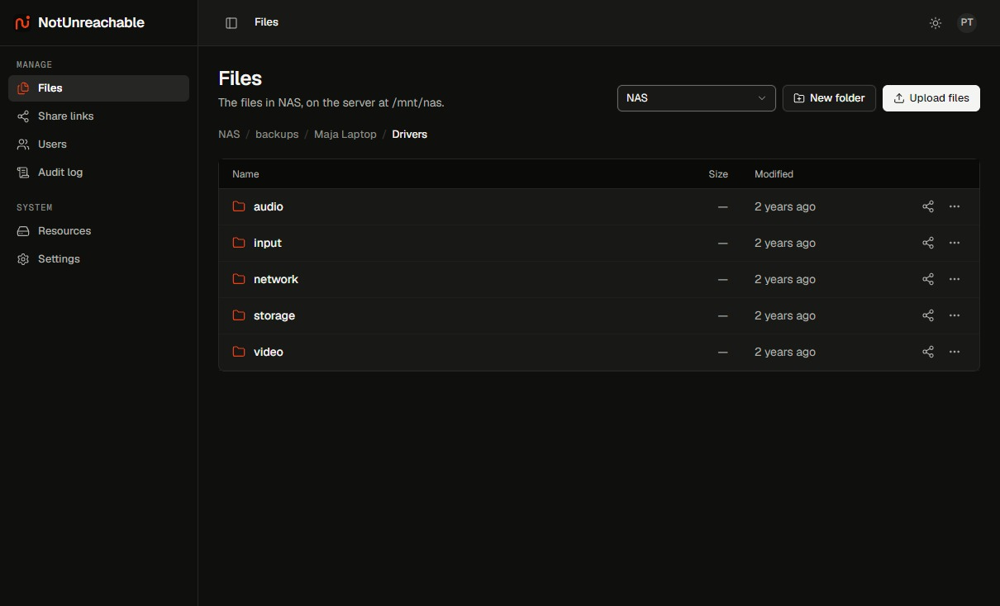
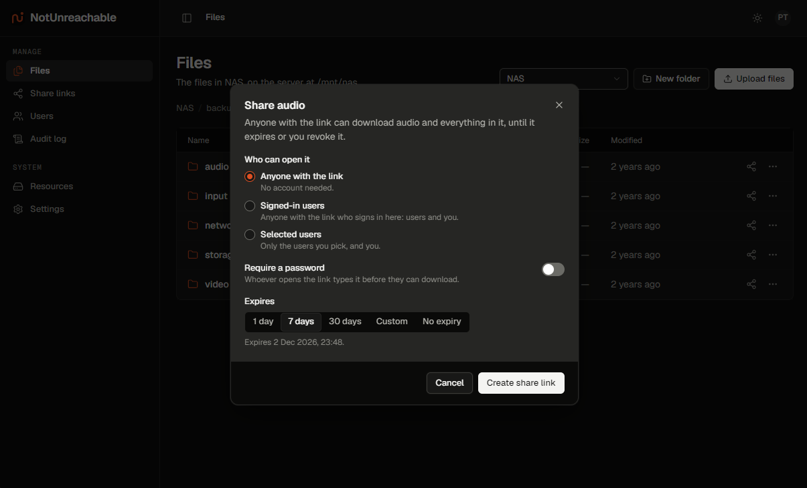

# NotUnreachable

A self-hosted, multi-user file-sharing app that is safe to expose to the
Internet. One admin maps local folders and SMB shares, browses and manages
them, and hands out share links with passwords and expiry dates. Invited users
each get a home folder and see nothing else. Uploads resume after a broken
connection, and so do downloads.

It is for anyone who wants to share files from their own Linux server, such as
a home server or a small office's, without handing them to a cloud service. It
runs as one hardened systemd service behind a TLS reverse proxy (Caddy or
nginx), on Debian, Ubuntu, Fedora or RHEL, on x86-64 or arm64.





## Buy me a coffee

If NotUnreachable is useful to you, you can support its development.

<a href="https://buymeacoffee.com/przemczan"></a>

## Install

```sh
curl -fsSL https://github.com/przemczan/not-unreachable/releases/latest/download/install.sh | sudo bash
```

It downloads the latest release for your server, checks it against the
release's `SHA256SUMS`, and installs it. Run the same command to upgrade.
[docs/install.md](docs/install.md) has the rest: what you need, the options,
installing by hand, the reverse proxy, the first admin, backups and uninstall.

## Design

The design every part is built on is in [docs/design/](docs/design/README.md):
the [stack](docs/design/stack.md), the [domain](docs/design/domain.md),
[deployment](docs/design/deployment.md), [SMB shares](docs/design/smb.md), the
[design system](docs/design/design-system.md) and the
[threat model](docs/design/threat-model.md). The latest security review is in
[docs/security/review.md](docs/security/review.md).

## Develop

You need Node 24, 24.11 or newer (`.nvmrc`), and pnpm, through Corepack
(`corepack enable`), or the dev container in `.devcontainer/`.

```sh
pnpm install            # dependencies
pnpm build              # every package and app
pnpm lint               # oxlint, then the brand check
pnpm typecheck          # TypeScript
pnpm format:check       # Prettier (pnpm format fixes it)
pnpm test               # unit and integration tests (Vitest)
pnpm exec playwright install --with-deps chromium
pnpm test:e2e           # end-to-end tests (Playwright), after pnpm build
```

The code is a pnpm workspace: `apps/server` (Fastify), `apps/web` (React),
`packages/contracts` (the API's types), `packages/design-system`, and
`deploy/` (the installer, the systemd units and the SMB mount helper).

Commit messages follow Conventional Commits, as every push to `main` releases
from them; see [CONTRIBUTING.md](CONTRIBUTING.md).

## License

NotUnreachable is free software under the
[GNU General Public License, version 3](LICENSE).
